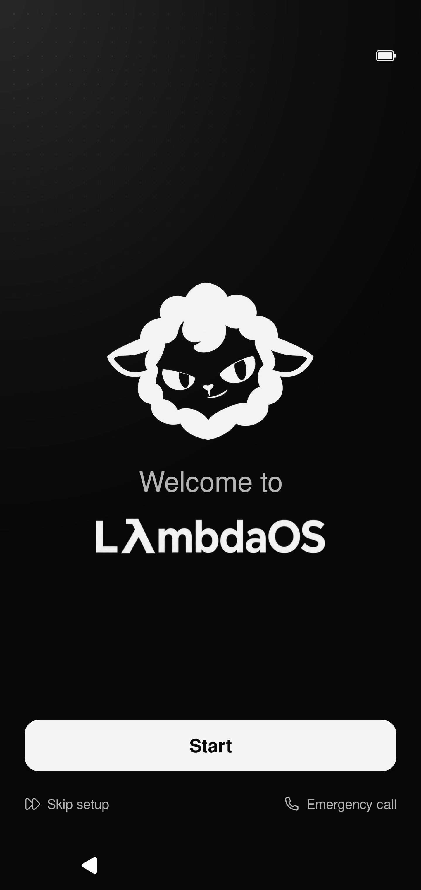
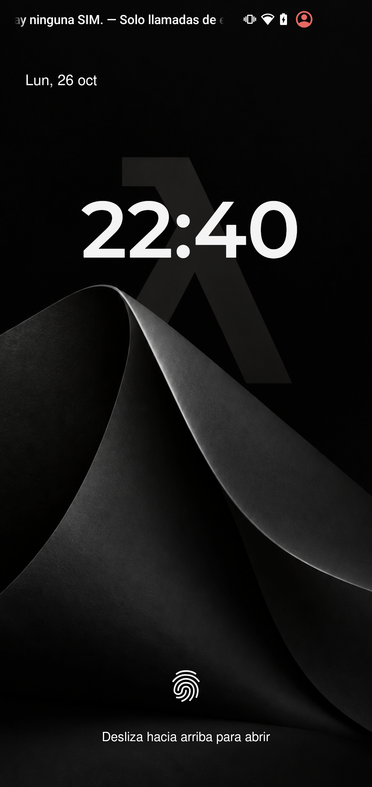
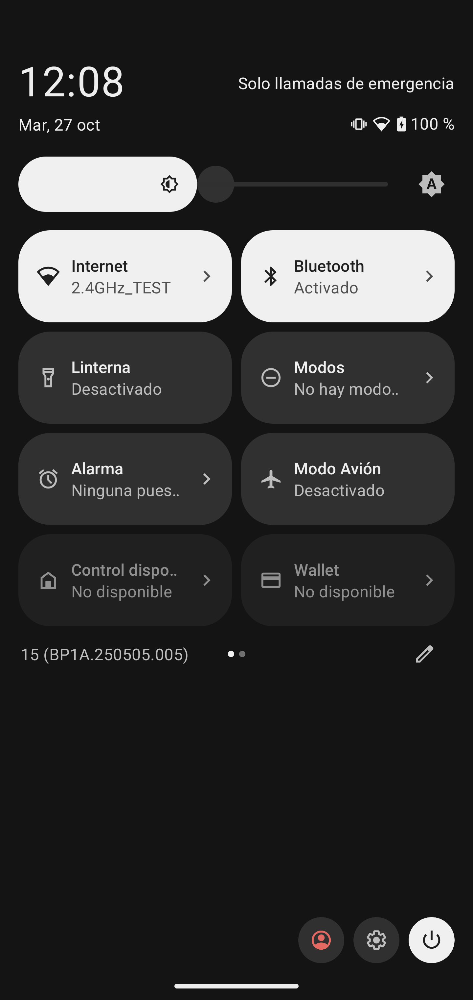

  

  <strong>A pentesting-dedicated Android operating system for the Samsung Galaxy S10.</strong>

  
  
  
  

  <a href="https://github.com/samilososami/LambdaOS/releases">Releases</a> ·
  <a href="ROADMAP.md">Roadmap</a> ·
  <a href="docs/DEVELOPMENT.md">Development</a> ·
  <a href="assets/README.md">Asset library</a>

LambdaOS is an Android system built around one device and one direction: a
purpose-built mobile environment for penetration testing and security research.
It combines a restrained monochrome interface with device-specific development
for the Exynos Samsung Galaxy S10.

The project is currently in **alpha**, based on **LineageOS 22.2 / Android 15**.
The system boots on the reference device, with a custom setup experience,
wallpapers and system styling already implemented. Kernel capabilities, shared
system commands and the operational toolset are the next focus.

## On the device

<table>
  <tr>
    <td align="center" width="33%"> First-run setup</td>
    <td align="center" width="33%"> Lock screen</td>
    <td align="center" width="33%"> Quick settings</td>
  </tr>
</table>

These are captures from running development builds on the S10, rather than
concept renders. Some screens are in Spanish. The wider design archive includes
earlier explorations and proposed features; those are labeled separately in the
[asset library](assets/README.md).

## What is taking shape

- **A custom first run.** A dedicated setup flow with language and region,
  connectivity, accessibility, security, appearance, navigation and haptics.
- **A consistent visual identity.** Near-black surfaces, off-white text, quiet
  gradients, original wallpapers and a custom boot animation. Dark and light
  appearance can select the initial wallpaper during setup.
- **Native Android foundations.** System styling extends into Settings and
  compatible apps while authentication and biometrics use platform services.
- **Lambda Operator.** The included Lambda application is the starting point
  for a unified interface to device information and future security workflows.
  Its Wi-Fi, Bluetooth, USB, CAN, network and radio categories are under development.
- **S10-tuned WPA/PMKID cracking.** A native ARM64 CPU engine, tuned and tested
  on the Exynos 9820 to make effective use of the Galaxy S10's hardware while
  retaining thermal and memory safeguards. Eight-thread tests reached a median
  of **3,506 password attempts/s**; a complete 4,800-candidate WPA2 batch took
  **1.87 s**. These are short, synthetic tests in the development APK, not
  sustained-performance guarantees or a feature in a published ROM. GPU
  acceleration remains experimental and has not passed correctness validation.
- **Hardware-first development.** Kernel, driver and external-adapter support
  will be documented against capabilities actually verified on the device.

Lamb, the local AI assistant, has a preserved research checkpoint. Model work
is paused while the operating system and its command interfaces are defined.
The ROM does not currently bundle an AI model. See the [roadmap](ROADMAP.md).

## Device and project status

| | Current scope |
|---|---|
| Reference device | Samsung Galaxy S10 **SM-G973F** |
| Codename / platform | `beyond1lte` / Exynos 9820 |
| Base | Android 15, LineageOS 22.2 |
| Development line | `0.1.0-alpha.2` |
| Google apps | Not bundled |
| Other S10 variants | Not validated by this project |
| Public ROM downloads | Pending preparation of the first public release |

This repository contains the project-specific source snapshot, documentation
and artwork. It is not the complete Android source tree. A finished pentesting
toolset, a custom NetHunter kernel and compatibility with other devices are
roadmap items, not claims about the current alpha.

## Downloads

Flashable ROMs will be distributed through [GitHub Releases](https://github.com/samilososami/LambdaOS/releases),
with the exact device target, SHA-256 checksums, installation notes and known
issues. No public flashable ZIP is attached to this initial repository snapshot.

The automatic **Source code** archives on GitHub are source snapshots, not ROMs.
Read the [release policy](releases/README.md) before using a future build.

## Explore the repository

| Path | Contents |
|---|---|
| [`alpha/apps`](alpha/apps) | Lambda app and the Lambda-modified LineageOS setup wizard |
| [`alpha/platform`](alpha/platform) | Settings, SystemUI, Telephony and Seedvault integration resources |
| [`alpha/patches`](alpha/patches) | Platform changes and build integration patches |
| [`alpha/vendor`](alpha/vendor) | Lambda product configuration and resource overlays |
| [`alpha/manifests`](alpha/manifests) | Device source manifest |
| [`alpha/scripts`](alpha/scripts) | Selected build, staging and verification helpers |
| [`assets`](assets) | Branding, wallpapers, screenshots, mockups and design iterations |
| [`docs`](docs) | Development notes, source scope and checkpoint information |
| [`releases`](releases) | Public release requirements and packaging conventions |

## Development

Start with the [development guide](docs/DEVELOPMENT.md) and
[current roadmap](ROADMAP.md). This is an early, actively changing project;
clear bug reports with the device variant, build identifier and reproduction
steps are useful. Keep private device data and credentials out of public reports.

## Credits

Created by **Sami González Kamel** — [@samilososami](https://github.com/samilososami)
· [samilososami.com](https://samilososami.com).

Built on the work of the Android Open Source Project, LineageOS and the
maintainers of the Samsung Exynos device platform. Existing license notices
and third-party asset credits are preserved; see [NOTICE.md](NOTICE.md).
LambdaOS is an independent project and is not affiliated with Samsung or LineageOS.
