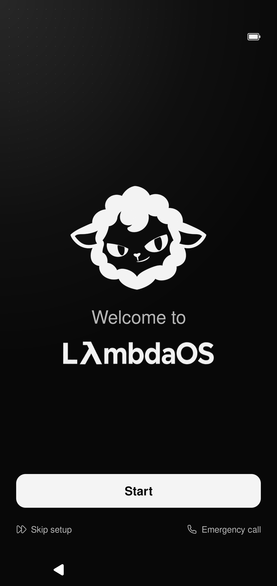
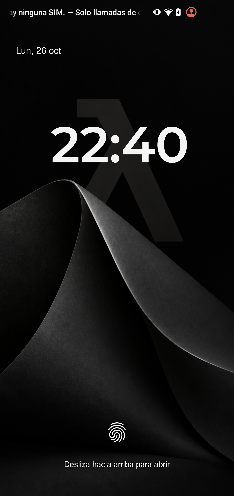
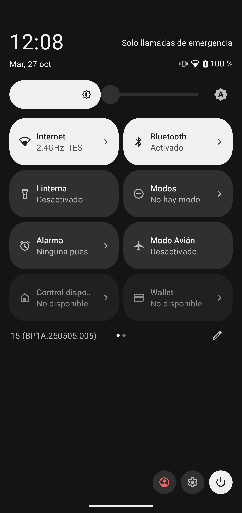

<p align="center">
  
</p>

<p align="center">
  <strong>A pentesting-dedicated Android operating system for the Samsung Galaxy S10.</strong>
</p>

<p align="center">
  
  
  
  
  
</p>

<p align="center">
  <a href="https://lambdaos.samilososami.com/">Website</a> ·
  <a href="ROADMAP.md">Roadmap</a> ·
  <a href="docs/DEVELOPMENT.md">Development</a> ·
  <a href="docs/ARCHITECTURE.md">Architecture</a> ·
  <a href="assets/README.md">Assets</a>
</p>

LambdaOS is an Android system built around a single reference device and a
clear purpose: make security work on a phone coherent, inspectable and usable.
It combines a restrained native interface with a device-specific kernel,
structured privileged operations and workflows for supported radio hardware.

The project is in **alpha**, based on **LineageOS 22.2 / Android 15** for the
Exynos Samsung Galaxy S10. The current repository is a reviewed, project-specific
source snapshot. It does not contain the complete Android tree, proprietary
Samsung blobs, private signing material, model weights or flashable ROM images.

## On the device

<table>
  <tr>
    <td align="center" width="33%"><br><sub>First-run setup</sub></td>
    <td align="center" width="33%"><br><sub>Lock screen</sub></td>
    <td align="center" width="33%"><br><sub>Quick settings</sub></td>
  </tr>
</table>

These are captures from development builds running on the reference S10. The
larger visual archive also contains concepts and earlier iterations; those are
identified as design material rather than implemented screens.

## Current components

### Lambda Base

- Android 15 / LineageOS 22.2 product configuration for `beyond1lte`.
- Lambda first-run assistant, boot artwork, wallpapers and monochrome system
  styling.
- Platform integrations for Settings, SystemUI, Telephony and Seedvault.
- A no-GApps development line using the stable LambdaOS signing identity.

### Lambda Kernel

- Kernel line `4.14.356-lambdaos+` with a published configuration, patch set and
  reproducible helper scripts.
- External wireless-driver work for selected Realtek and MediaTek families,
  SocketCAN, USB serial/networking, USB gadget/HID and SDR-oriented options.
- Physically verified monitor reception with the internal BCM4375B1 path and an
  ALFA AWUS036ACH on 2.4 GHz. Injection, 5 GHz and sustained capture are separate
  validation gates and are not claimed here.
- USB/IP VHCI remains disabled: a runtime failure was observed and the prepared
  source guard has not yet passed a flashed-device retest.

See the [kernel source snapshot](kernel/README.md) and
[capability matrix](kernel/CAPABILITY-MATRIX.md).

### Lambda Operator and Core

The native `org.lambdaproject.lambda` application is the current control centre.
The published `0.2.0-operator.4` development source includes:

- hardware-aware Wi-Fi discovery and internal/external adapter selection;
- bounded capture sessions with durable receipts and explicit target state;
- separately confirmed active assistance, never implicit in passive capture;
- WPS workflows backed by a pinned OneShot-Extended integration;
- quick and dedicated offline WPA/WPA2 candidate verification;
- ARM64 CPU and CPU + Mali hybrid PMK research paths with thermal guards;
- connect/save/autojoin only from an independently verified result;
- a persistent foreground Core process with typed Binder/provider boundaries.

These components are intended for systems and networks the operator owns or is
authorized to assess. The privileged worker is still a development deployment:
the APK alone does not make every backend ROM-persistent. See
[Operator status](docs/OPERATOR.md), [architecture](docs/ARCHITECTURE.md) and
[security model](docs/SECURITY-MODEL.md).

### Lamb

The local assistant has a preserved research checkpoint based on the Gemma 4
E2B mobile line. Fine-tuning and ROM integration are paused while Core and
Operator contracts stabilize. No model weights are stored in this repository
and the current ROM does not bundle Lamb. See [the checkpoint](docs/LAMB-CHECKPOINT.md).

## Verified development status

| Area | Current boundary |
|---|---|
| Reference device | Samsung Galaxy S10 **SM-G973F** |
| Codename / platform | `beyond1lte` / Exynos 9820 |
| Base | Android 15, LineageOS 22.2 |
| ROM line | `0.1.0-alpha.2` |
| Operator source | `0.2.0-operator.4` (`versionCode 24`) |
| Kernel line | `4.14.356-lambdaos+` |
| Google apps | Not bundled |
| Other device variants | Not validated |
| Public flashable release | Not yet published |

Build, package, installation and physical verification are tracked separately.
A passing host build is not presented as proof of a radio or device capability.

## Repository map

| Path | Contents |
|---|---|
| [`alpha/apps/Lambda`](alpha/apps/Lambda) | Lambda Operator and Core source |
| [`alpha/apps/SetupWizard`](alpha/apps/SetupWizard) | Lambda-modified setup assistant |
| [`alpha/platform`](alpha/platform) | Selected platform integration source |
| [`alpha/patches`](alpha/patches) | Android build and platform patches |
| [`alpha/vendor`](alpha/vendor) | Product configuration and overlays |
| [`alpha/tests`](alpha/tests) | Reviewed synthetic contract tests |
| [`kernel`](kernel) | Kernel configs, patch, scripts and capability matrix |
| [`assets`](assets) | Branding, screenshots, wallpapers and design archive |
| [`docs`](docs) | Architecture, development and status documentation |
| [`releases`](releases) | Release policy and packaging requirements |

The exact implementation inventory and SHA-256 hashes are recorded in
[`docs/source-inventory.json`](docs/source-inventory.json).

## Building the standalone Operator APK

Prerequisites: Python 3, JDK 21, Android SDK Platform 35 and Build Tools 35.0.0.

```sh
export LAMBDA_ANDROID_SDK=/path/to/android-sdk
export LAMBDA_JAVA_HOME=/path/to/jdk-21
python3 alpha/scripts/build_lambda.py
```

The script creates a local development key under ignored `alpha/private/` and
writes the APK to ignored `alpha/out/`. This is an APK build check, not a ROM
build or a complete privileged-runtime installation. Commands in this repository
are written to work when invoked as the normal `kali` user or through root on the
maintainer's development host; root build entry points drop privileges before
creating user-owned output.

Full ROM build requirements and publication boundaries are documented in the
[development guide](docs/DEVELOPMENT.md). There is no supported public install
procedure until a reviewed ZIP, checksum and release note are attached to a
GitHub Release.

## Responsible use

LambdaOS is developed for authorized security testing, research and defensive
validation. Radio discovery is not authorization. Active operations must be
scoped to an explicitly authorized target and should comply with applicable law.
The project does not treat a tool exit code, generated text or visible SSID as
proof of success or permission.

## Credits

Created by **Sami González Kamel** — [@samilososami](https://github.com/samilososami)
· [samilososami.com](https://samilososami.com).

Built on Android Open Source Project, LineageOS, the Samsung Exynos community
and the upstream projects named in [NOTICE.md](NOTICE.md). LambdaOS is independent
and is not affiliated with Samsung or LineageOS.

## Support

LambdaOS is developed by one person, alongside my studies. Supporting the
project is completely optional: nothing here is paid, and nothing changes if
you don't. Every contribution goes towards hardware, time and motivation to
keep going.

- **Bitcoin (BTC):** `bc1qa8r8ll0m0e58f3ngrauh08nnzdn0alm825nc3r`
- **Litecoin (LTC):** `ltc1qtpyddqcq6vscm0gyajkgp3y2r7msdnfythzgua`
- **PayPal:** [@samilososami](https://paypal.me/samilososami)
- **Revolut:** [@samilososami](https://revolut.me/samilososami)

Only send what you can spare. Crypto transfers are final; double-check the
address before sending.
